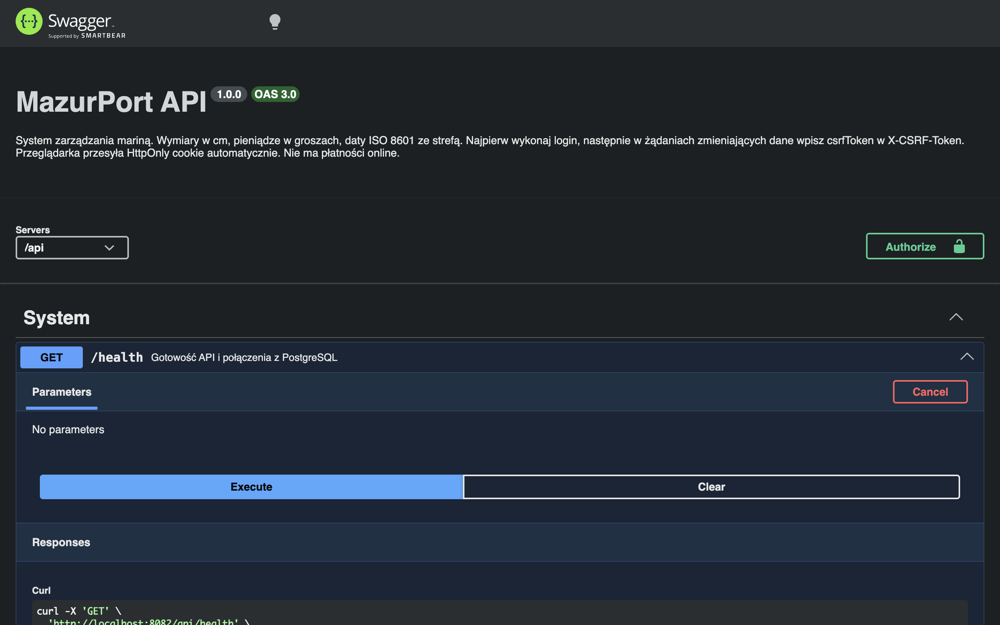

# Korzystanie z API

Pełna specyfikacja: `/api/openapi.json`. Interaktywny klient: `/api/docs/`. OpenAPI używa względnego adresu `/api`, więc działa na porcie bieżącego środowiska.

## Przykład w Swagger UI

1. Rozwiń `POST /auth/login`, wybierz **Try it out** i wpisz dane konta demonstracyjnego.
2. Wybierz **Execute**. W rzeczywistym **Server response** odczytaj `csrfToken`. Cookie sesji zapisuje przeglądarka.
3. Wykonaj `GET /boats` i `GET /berths`. Skopiuj rzeczywiste UUID zasobów.
4. Dla `POST /reservations` ustaw `X-CSRF-Token` oraz `boat_id`, `berth_id`, `starts_at`, `ends_at`. Termin musi być przyszły i zawierać strefę, np. `2027-07-01T12:00:00+02:00`.
5. Powtórzenie żądania dla zajętego terminu zwraca 409. Cudzy jacht zwraca 404. Zbyt duży jacht zwraca 422.

Przycisk Authorize nie wpisuje cookie HttpOnly za przeglądarkę. Do zwykłego testowania używaj endpointu logowania; token CSRF wpisuj w nagłówku operacji zmieniającej dane. Wylogowanie unieważnia cookie po stronie serwera.



## Przykład curl

Poniżej lokalny pokaz z użyciem `jq`. Plik cookie jest tymczasowy, poza repozytorium.

```sh
COOKIE_JAR=$(mktemp)
LOGIN=$(curl -sS -c "$COOKIE_JAR" http://localhost:8082/api/auth/login \
  -H 'Content-Type: application/json' \
  -d '{"email":"zeglarz@mazurport.local","password":"PortDemo123!"}')
CSRF=$(printf '%s' "$LOGIN" | jq -r .csrfToken)

curl -sS -b "$COOKIE_JAR" 'http://localhost:8082/api/boats?sort=name&limit=10'
curl -sS -b "$COOKIE_JAR" 'http://localhost:8082/api/reservations?status=CONFIRMED&page=1&limit=10'

curl -sS -b "$COOKIE_JAR" -X POST http://localhost:8082/api/boats \
  -H 'Content-Type: application/json' -H "X-CSRF-Token: $CSRF" \
  -d '{"name":"Fala","registration":"POL-777","length_cm":800,"width_cm":270,"draft_cm":130}'

curl -sS -b "$COOKIE_JAR" -X POST http://localhost:8082/api/auth/logout \
  -H "X-CSRF-Token: $CSRF"
rm "$COOKIE_JAR"
```

## Grupy endpointów

| Ścieżka | Metody / przeznaczenie |
| --- | --- |
| `/auth/register`, `/auth/login`, `/auth/logout`, `/auth/me` | Rejestracja, sesja i wylogowanie |
| `/boats`, `/boats/{id}` | GET, POST, PUT, DELETE własnych jachtów |
| `/berths`, `/berths/{id}`, `/berths/{id}/status` | Katalog, administracja i zamknięcie/otwarcie |
| `/availability` | GET, dopasowanie miejsca do jachtu i przedziału |
| `/reservations`, `/reservations/{id}` | Tworzenie, lista i szczegóły |
| `/reservations/{id}/cancel` | POST, anulowanie |
| `/reservations/{id}/check-in`, `/check-out` | POST, obsługa pobytu |
| `/faults`, `/faults/{id}` | GET, POST i PATCH, cykl naprawy |
| `/users`, `/users/{id}` | GET i PATCH administratora |
| `/notifications`, `/notifications/{id}/read` | Własne powiadomienia i odczyt |
| `/activity`, `/dashboard`, `/health` | Dziennik, statystyki, gotowość |

Listy zwracają `{data, total, page, limit}`. Limit wynosi maksymalnie 100. Jachty, miejsca, rezerwacje, usterki i użytkownicy obsługują wyszukiwanie; dostępne filtry i sortowanie opisuje Swagger. Zdarzenia i powiadomienia są uporządkowane od najnowszych. Nazwy statusów rezerwacji: `CONFIRMED`, `CHECKED_IN`, `COMPLETED`, `CANCELLED`.

## Błędy

```json
{
  "error": {
    "code": "CONFLICT",
    "message": "Wybrany termin jest już zajęty."
  }
}
```

| HTTP | Znaczenie |
| --- | --- |
| 400 | Niepoprawny JSON |
| 401 | Brak sesji, sesja wygasła lub błędne logowanie |
| 403 | Rola, CSRF lub Origin nie pozwala na operację |
| 404 | Brak zasobu lub brak dostępu właściciela |
| 409 | Konflikt terminu, aktywna rezerwacja lub błędny stan |
| 413 | Body większe niż 32 kB |
| 422 | Błąd DTO, wymiarów lub okresu |
| 429 | Zbyt wiele prób logowania/rejestracji |
| 500 | Nieoczekiwany błąd bez ujawnienia szczegółów serwera |

201 oznacza utworzenie, 200 poprawny odczyt/zmianę, 204 usunięcie/wylogowanie bez body. Wszystkie kwoty są całkowitymi groszami, wymiary centymetrami. Terminy API to ISO 8601; frontend pokazuje strefę Europe/Warsaw i przelicza wpisane terminy na UTC.
