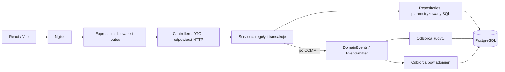
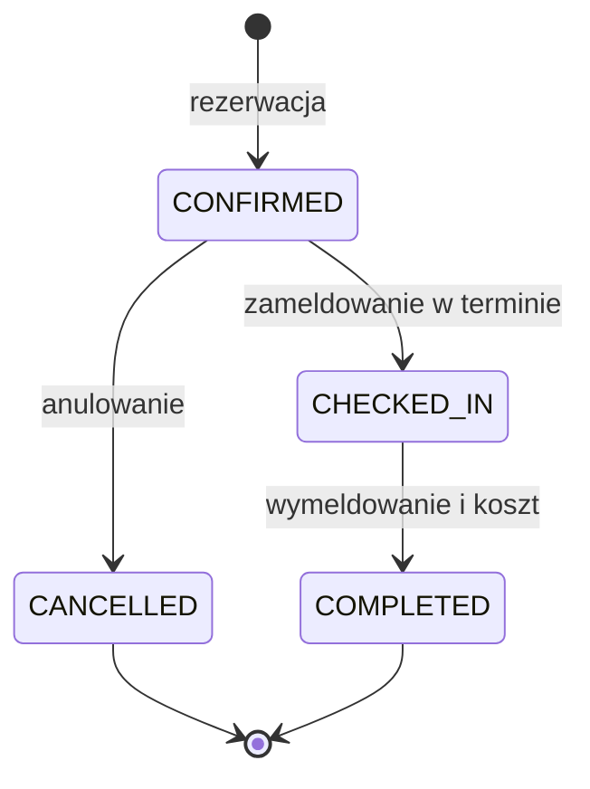

# Architektura MazurPort

## Przepływ żądania

React pobiera dane przez względne `/api`. Nginx przekazuje żądania do Express, dzięki czemu frontend i API mają wspólne origin. Vite stosuje taki sam proxy w trybie developerskim. Nie potrzeba otwartego CORS.

Warstwa routingu wybiera kontroler i wymaganą rolę. Kontrolery walidują DTO przy użyciu Zod. Serwisy podejmują decyzje biznesowe, repozytoria korzystają z `pg` i parametrów `$1`, `$2` zamiast składania danych użytkownika do SQL. Nazwy kolumn sortowania pochodzą z zamkniętej listy. Transakcja zawsze używa jednego klienta połączenia.

## Najważniejsze reguły

1. Rezerwacja zaczyna się w przyszłości i trwa od jednej godziny do 30 dni. Przedziały mają postać `[początek, koniec)`, więc wyjazd o 12:00 i kolejny przyjazd o 12:00 nie kolidują.
2. Długość, szerokość i zanurzenie jachtu nie mogą przekraczać limitów miejsca. Wymiary są całkowitymi centymetrami. Granica równa limitowi jest dopuszczalna.
3. Aktywne rezerwacje jednego miejsca oraz jednego jachtu nie mogą się nakładać. `EXCLUDE USING gist` sprawdza tę regułę także przy równoczesnych żądaniach. Serwis blokuje wiersze jachtu i miejsca na czas transakcji.
4. Zamknięte miejsce nie przyjmuje rezerwacji ani meldowania. Krytyczne zgłoszenie zamyka je w tej samej transakcji. Rozwiązanie usterki nie otwiera miejsca automatycznie; obsługa robi to osobno. Wszystkie krytyczne usterki muszą być rozwiązane.
5. Zamknięcie miejsca nie usuwa istniejących rezerwacji. UI oznacza je ostrzeżeniem, a obsługa kontaktuje się z żeglarzem i może anulować potwierdzoną rezerwację. Jacht już zameldowany może zostać wymeldowany mimo zamknięcia.
6. Meldowanie jest możliwe wyłącznie w zarezerwowanym przedziale. Spóźniony wyjazd poprzednika blokuje kolejne meldowanie do czasu zwolnienia miejsca. Wymeldowanie jest możliwe tylko ze stanu `CHECKED_IN`.
7. Cena to liczba rozpoczętych dób × stawka z chwili rezerwacji. Wcześniejszy wyjazd nie daje zwrotu. Późniejszy wyjazd wydłuża okres naliczania do rzeczywistego czasu wymeldowania. Ceny nie zależą od późniejszej edycji cennika.
8. Żeglarz anuluje własną rezerwację przed początkiem pobytu. Obsługa może anulować dowolną potwierdzoną rezerwację, także spóźnioną. Stany zakończone nie pozwalają na ponowne meldowanie lub anulowanie.
9. Aktywne rezerwacje blokują archiwizację jachtu/miejsca i zmianę ich wymiarów. Archiwizacja zachowuje klucze obce oraz historię. Zmiana nazwy i przyszłej stawki jest dozwolona.
10. Administrator nie zmienia własnych uprawnień. Nie wolno wyłączyć ostatniego aktywnego administratora. Zmiana roli lub aktywności konta unieważnia wszystkie jego sesje.

## Uwierzytelnianie i bezpieczeństwo

Hasła są hashowane przez `scrypt` z losową solą. Logowanie ma ograniczenie liczby prób, a nieistniejący e-mail przechodzi kosztowną weryfikację zastępczą, aby ograniczyć różnice czasu odpowiedzi.

Sesja zawiera losowy token 256-bitowy; w bazie zapisany jest tylko jego SHA-256. Przeglądarka otrzymuje cookie `HttpOnly`, `SameSite=Lax`, `Path=/api`, ważne przez siedem dni. Produkcyjny HTTPS wymaga flagi `Secure`. Token nie trafia do localStorage. Logout usuwa sesję z bazy.

Żądania zmieniające dane wymagają `X-CSRF-Token`, odczytanego po logowaniu lub przez `/auth/me`. Backend sprawdza też `Origin`, jeśli nagłówek występuje. Rejestracja zawsze tworzy rolę `SAILOR`; dodatkowe pola w DTO są odrzucane. Każde chronione żądanie sprawdza aktualną rolę i aktywność konta w bazie.

Własność jest sprawdzana w backendzie. Cudzy jacht, cudza rezerwacja żeglarza i cudze powiadomienie zwracają 404. Ukrycie przycisku we frontendzie nie jest zabezpieczeniem. Błędy HTTP mają jednolity format, bez stack trace i SQL. Body ograniczono do 32 kB; Helmet ustawia nagłówki ochronne. React renderuje tekst bez `dangerouslySetInnerHTML`.

## Zdarzenia i cykl życia

`reservation.created`, `reservation.cancelled`, `reservation.checked_in`, `reservation.checked_out`, `fault.reported`, `fault.updated`, `berth.status_changed` i `user.updated` uruchamiają niezależnych odbiorców. Audyt trafia do `audit_events`, wiadomości żeglarza do `notifications`. Publikacja odbywa się dopiero po sukcesie transakcji, więc konflikt nie generuje fałszywego potwierdzenia.

Odbiorcy są uruchamiani przez Promise poza synchronicznym stosem operacji. Każdy ma osobne przechwycenie błędu. Przy SIGTERM/SIGINT serwer przestaje przyjmować połączenia, czeka na trwające odpowiedzi i zadania zdarzeń, zamyka pulę PostgreSQL. Po 10 sekundach wymusza zakończenie. Brak trwałej kolejki i retry jest świadomym ograniczeniem tego projektu.

## Baza i uruchamianie

Migracje są wersjonowane i wykonywane pod blokadą doradczą PostgreSQL. Każdy plik migracji jest transakcją. Tabela `migrations` przechowuje wykonane wersje. Seed nie jest automatycznie uruchamiany przy każdym starcie.

Compose rozdziela bazę, API i Nginx. Backend czeka na healthcheck bazy, frontend na API. Dane aplikacji pozostają w nazwanym wolumenie. Osobna baza testowa używa `tmpfs` i nigdy nie współdzieli wolumenu z aplikacją. Kontenery backendu i frontendu działają bez roota.
