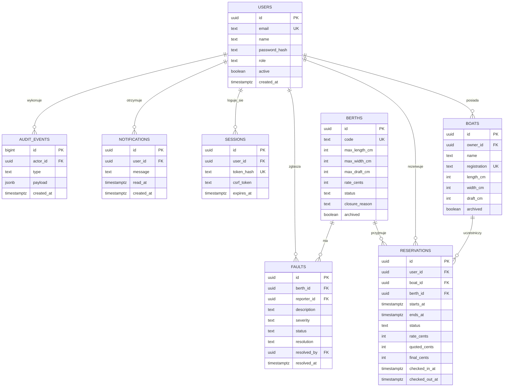

# Diagram ERD

Pięć encji domenowych to użytkownik, jacht, miejsce, rezerwacja i usterka. Sesja, zdarzenie audytu i powiadomienie obsługują bezpieczeństwo oraz komunikację.

Rezerwacje przechowują stawkę z chwili utworzenia. Wymiary są w centymetrach, kwoty w groszach, daty jako `timestamptz`. Jachty i miejsca są archiwizowane zamiast kasowania historii. Klucze obce wymuszają spójność; e-maile, numery rejestracyjne i oznaczenia miejsc są unikalne.

Ograniczenia `berth_no_overlap` i `boat_no_overlap` korzystają z `btree_gist` i przedziałów `tstzrange`. Obejmują stany `CONFIRMED` i `CHECKED_IN`, więc anulowana albo zakończona rezerwacja nie blokuje nowego terminu. Indeksy częściowe chronią również bieżące meldowanie. Dokładny model znajduje się w migracjach SQL.
